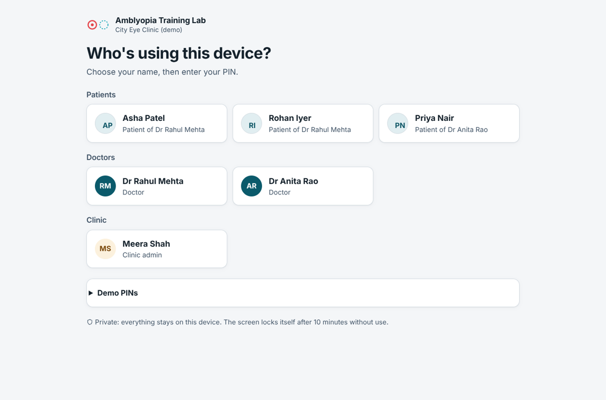
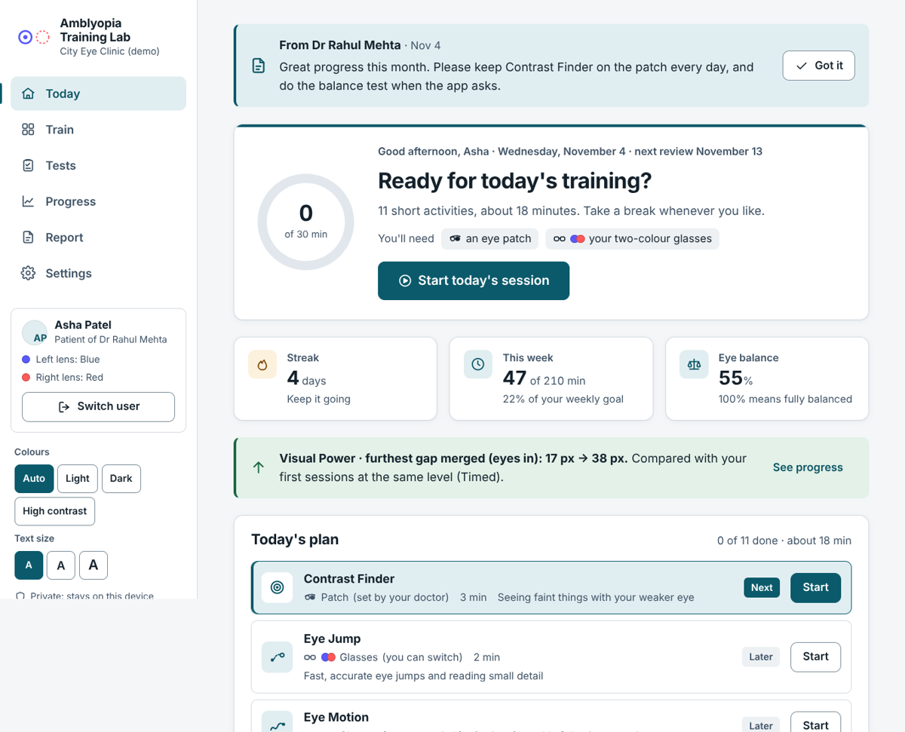
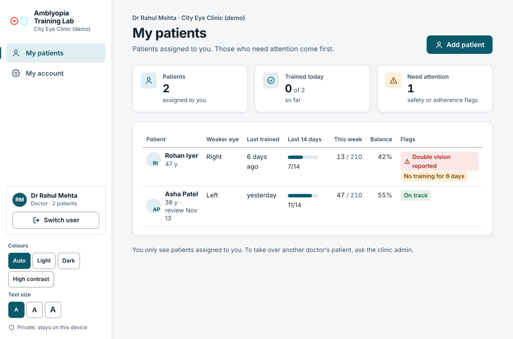
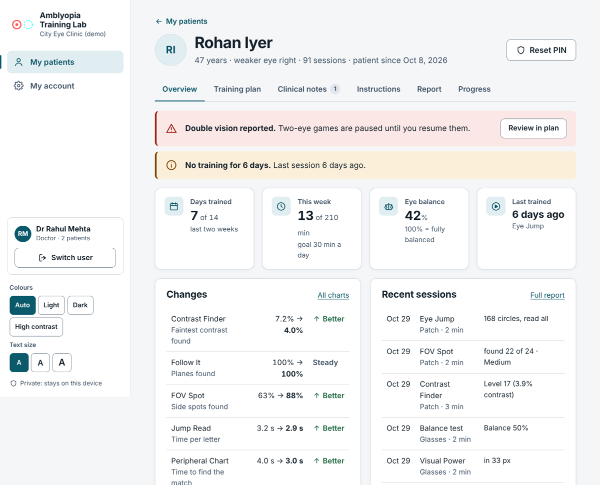
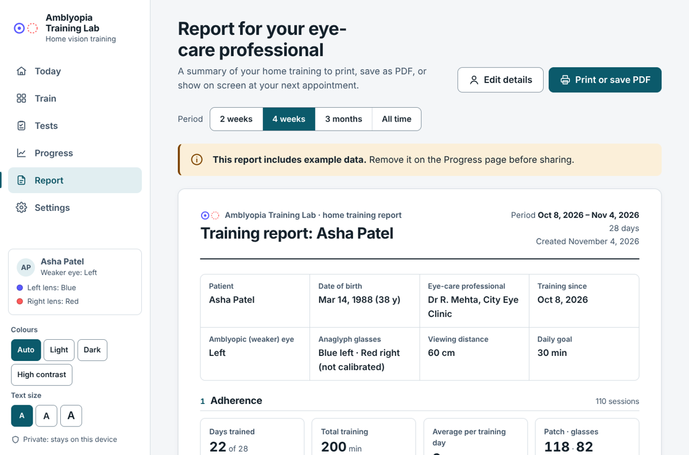
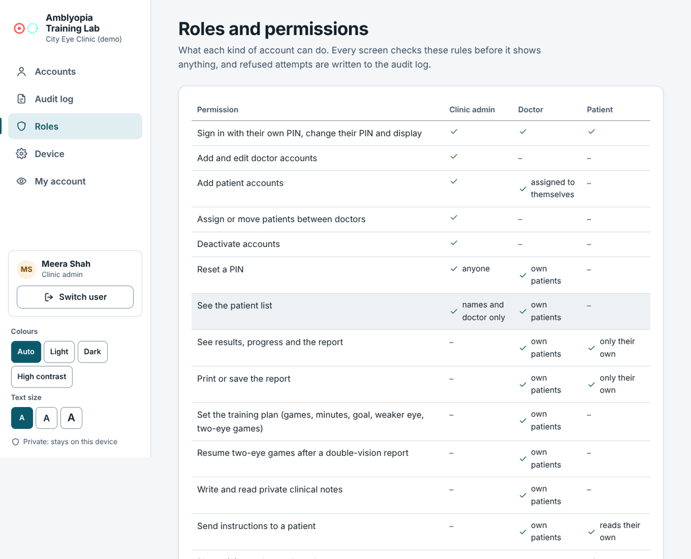
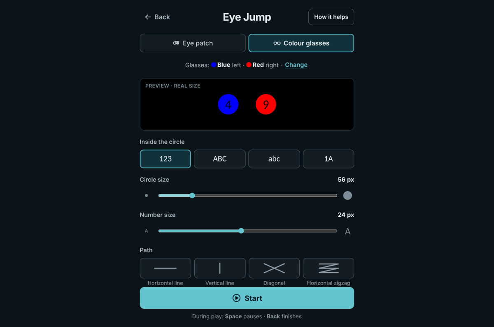

# Amblyopia Training Lab

Game-based home vision training for **adults with amblyopia** (lazy eye), with separate accounts for the **clinic admin**, **doctors** and **patients**. It runs entirely in the browser: no server, no install, works offline.

Patients train with an eye patch (monocular) or red/blue anaglyph glasses (dichoptic). Doctors set each patient's plan and follow their results. The clinic admin manages accounts.

> **Research prototype, not a medical device.** Use it with an eye-care professional's knowledge.



## Contents

- [Quick start](#quick-start)
- [Features](#features)
- [Roles and access](#roles-and-access)
- [The 12 games](#the-12-games)
- [Screenshots](#screenshots)
- [Design and accessibility](#design-and-accessibility)
- [How the rendering works](#how-the-rendering-works)
- [Build from source](#build-from-source)
- [Project structure](#project-structure)
- [Privacy and limits](#privacy-and-limits)

## Quick start

1. Download or clone this repository.
2. Open **`dist/index.html`** in a recent Chrome, Edge or Firefox on a laptop or desktop. WebGL2 is required.
3. On first run, choose **Load the demo clinic** to try every role with example results, or **Start a new clinic** to create your own admin account.

Demo accounts (PINs):

| Account | Role | PIN |
| --- | --- | --- |
| Meera Shah | Clinic admin | `1111` |
| Dr Rahul Mehta | Doctor | `2222` |
| Dr Anita Rao | Doctor | `3333` |
| Asha Patel | Patient of Dr Mehta | `4444` |
| Rohan Iyer | Patient of Dr Mehta (double vision reported) | `5555` |
| Priya Nair | Patient of Dr Rao | `6666` |

**What patients need:** their usual glasses, an eye patch, red/blue (or red/cyan, red/green) 3D glasses, and a bank card to measure the screen during setup.

## Features

**For patients**
- **Today:** a daily plan from the doctor, one *Start today's session* button that runs the activities back to back, instructions from the doctor, next review date, streak, weekly minutes and eye balance.
- **12 games** with their own settings pages: real-size previews, Easy / Medium / Hard / Extreme presets or Custom, and eye patch or colour glasses mode.
- **Two check-ups:** a dichoptic balance test (weekly) and a home letter-size test (every two weeks).
- **Safety:** a glasses check before two-eye play, a "how do your eyes feel?" check after every activity, and an automatic pause of two-eye games after a double-vision report. Only the doctor can resume them.
- **Progress** charts (higher always means better) and a **report** to print or save as PDF.
- **Setup:** weaker eye and consent, screen-size calibration with a bank card, viewing distance, and a "black test" that tunes each lens colour.

**For doctors**
- **My patients:** only the patients assigned to them, sorted so flags come first (double vision, no training for 3+ days, low adherence, eye strain, glasses not calibrated).
- **Patient record:** overview, training plan, private clinical notes, instructions with read receipts, the full report and progress charts.
- **Training plan:** games on or off; patch-only, glasses-only or the patient's choice for each game; daily goal; weaker eye; two-eye games allowed or not; next review date.

**For the clinic admin**
- Add doctors, patients and admins; assign and move patients between doctors; reset PINs; deactivate accounts.
- Audit log, roles and permissions page, device backup, restore and reset, and the auto-lock time.

**Report for the eye-care professional:** 2 weeks, 4 weeks, 3 months or all time. It includes patient details, adherence (days trained, minutes, patch vs glasses, daily chart), check-up trends, a table of all 12 activities (sessions, minutes, first → latest at the same level, trend, latest result) and eye comfort and safety. Prints on clean A4 pages.

## Roles and access

Everyone signs in on the shared device with their own 4–6 digit PIN.

| Permission | Clinic admin | Doctor | Patient |
| --- | --- | --- | --- |
| Change own PIN and display settings | ✓ | ✓ | ✓ |
| Add and edit doctor accounts | ✓ | – | – |
| Add patient accounts | ✓ | ✓ assigned to themselves | – |
| Assign or move patients between doctors | ✓ | – | – |
| Deactivate accounts | ✓ | – | – |
| Reset a PIN | ✓ anyone | ✓ own patients | – |
| See the patient list | ✓ names and doctor only | ✓ own patients | – |
| See results, progress and the report | – | ✓ own patients | ✓ only their own |
| Set the training plan | – | ✓ own patients | – |
| Resume two-eye games after a double-vision report | – | ✓ own patients | – |
| Private clinical notes | – | ✓ own patients | – |
| Send instructions | – | ✓ own patients | reads their own |
| Play training and record results | – | – | ✓ |
| Audit log; device backup, restore and reset | ✓ | – | – |

- **Every screen checks permissions** before showing anything (`can()` in `src/js/accounts.js`). Refused pages show "No access" and are written to the audit log.
- **PINs** are salted and hashed (SHA-256, 2,000 rounds). Five wrong PINs lock that account for 60 seconds.
- **Auto-lock:** the device returns to the sign-in screen after 2–30 minutes without use (10 by default), never during a game.
- **Least privilege:** the admin never sees results, doctors see only their own patients, and patients see only their own training.
- **Upgrading:** training data saved by a version from before accounts is kept as an unassigned patient (PIN `0000`, who is asked to change it).

## The 12 games

| Game | What you do | Trains |
| --- | --- | --- |
| Contrast Finder | Find a faint patch (blurry, striped or mixed) on a grey board; it gets fainter as you improve | Contrast sensitivity |
| Eye Jump | A circle jumps along a path; read the number or letter inside it out loud | Saccades, fast reading of detail |
| Eye Motion | Follow a gliding circle and read each new character | Smooth pursuit |
| Follow It | Remember the marked planes, follow them while they fly, then tap them | Multiple-object tracking |
| FOV Spot | Keep your eyes on the centre and tap spots that appear around it; a direction map shows misses | Peripheral detection |
| Jump Read | Find the alphabet in order in rows of random letters | Scanning and reading |
| OKN Stripes | Let your eyes follow drifting stripes; tap the star as it rides past | Optokinetic following and re-fixing |
| Peripheral Chart | Keep your eyes on the centre letter and tap its match on the spokes around it | Peripheral detail |
| Precision | Tap the exact centre of ringed targets, still or moving | Eye–hand accuracy |
| Rotation Match | Pick the copy that's only turned, not mirrored | Shape, direction, mental rotation |
| Split Vision | Keep your eyes on the centre and tap the matching object on a turning ring | Central and peripheral attention |
| Visual Power | Merge two random-dot diamonds and click the hidden 3D circle; each find pulls them further apart (glasses only) | Fusional vergence |

In colour-glasses mode, games split their content between the eyes (one lens colour each, plus a combined colour seen by both), so both eyes have to work together. Play screens are plain black with only a Back button.

## Screenshots

| | |
| --- | --- |
|  Patient: Today |  Doctor: My patients |
|  Doctor: patient record |  Report for the eye-care professional |
|  Admin: roles and permissions |  A game's settings page |

## Design and accessibility

The "Clinical calm" design is based on healthcare colour and accessibility research:

- **One brand colour (petrol teal) on cool white and slate.** Blue and teal are the most common healthcare colours and read as calm and trustworthy. Light blues look faded to older eyes, so the shade is deep and high-contrast. The interface never uses pure red, blue or cyan, so it can't be confused with a lens colour.
- **Contrast:** body text meets WCAG AAA (7:1) in Light and Dark themes; borders, icons and controls meet AA non-text contrast (3:1). A High contrast theme (yellow on black) is also available.
- **Type:** Atkinson Hyperlegible Next by the Braille Institute, designed for low-vision readers. Body text is 18 px or larger and scales to Large and Extra large.
- **Targets:** buttons are at least 44–50 px tall; the PIN pad has large keys.
- **Calm by design:** plain words, one main action per screen, no red "failure" states, and colour never carries meaning alone. Reduced-motion settings are respected.
- **Game settings pages stay dark**, so the eyes don't jump from a bright page to the black play screen.
- On phones and tablets the menu becomes a bottom tab bar.

## How the rendering works

Games draw two greyscale layers, one per eye, in linear luminance. A WebGL2 shader then:

- adds procedural Gabors and noise at float precision;
- gamma-encodes the result using the brightness match from Settings;
- applies noisy-bit dithering, so faint contrasts are reproducible on 8-bit screens;
- outputs grey (single-eye games) or, for two-eye games, multiplies each eye's image by that eye's calibrated lens colour and adds the two.

**Black test:** each eye's colour is tuned until it looks pure black through the other lens, so each eye sees only its own picture. Sizes come from the card calibration and viewing distance (pixels per degree).

## Build from source

Requires Node.js 18 or newer.

```bash
npm install
npm run build        # writes dist/index.html (a single self-contained file)
npx serve dist       # optional: serve over http://localhost
```

Data saved under `file://` and under `http://localhost` live in separate browser stores. The clinic admin can move everything with **Device → Save a backup / Restore a backup**.

## Project structure

```
src/
  index.html            page shell (CSS and JS are inlined at build time)
  styles.css            design tokens (light, dark, high contrast) and all components
  js/
    main.js             app shell, routing and role guards, patient pages (Today, Train, Tests, Progress, Report)
    accounts.js         accounts, PIN hashing and lockout, sessions, audit log, permission rules
    clinic.js           sign-in and setup, admin pages, doctor pages (patients, record, plan, notes, instructions)
    setup.js            Settings and the first-run welcome steps, including the black test
    runner.js           session flow: get ready, glasses check, countdown, game loop, summary, eye-feel check
    gl.js               WebGL2 compositor
    catalog.js          game list and the daily plan
    metrics.js          one comparable measure per game, with same-level trends
    store.js            per-patient data in localStorage, plan helpers
    lens.js, theme.js, charts.js, icons.js, util.js, staircase.js, draw.js, shapes.js
    games/              one file per game, plus balanceTest.js and crowdBreaker.js for the check-ups
build.mjs               esbuild bundle → dist/index.html
dist/index.html         ready-to-open build
docs/screenshots/       images used in this README
```

## Privacy and limits

- All data stays in the browser on the device where it was entered. Nothing is sent anywhere. The only network request is for web fonts, which fall back to system fonts offline.
- Accounts keep people out of each other's screens on a **shared device**. This is not server-grade security: someone with full access to the browser's storage could still read the data. Using it on several devices or in a hospital would need the same rules enforced on a server.
- Home measures (eye balance, letter size) depend on screen size, distance and lighting. They are for watching trends, not for diagnosis or prescribing.
